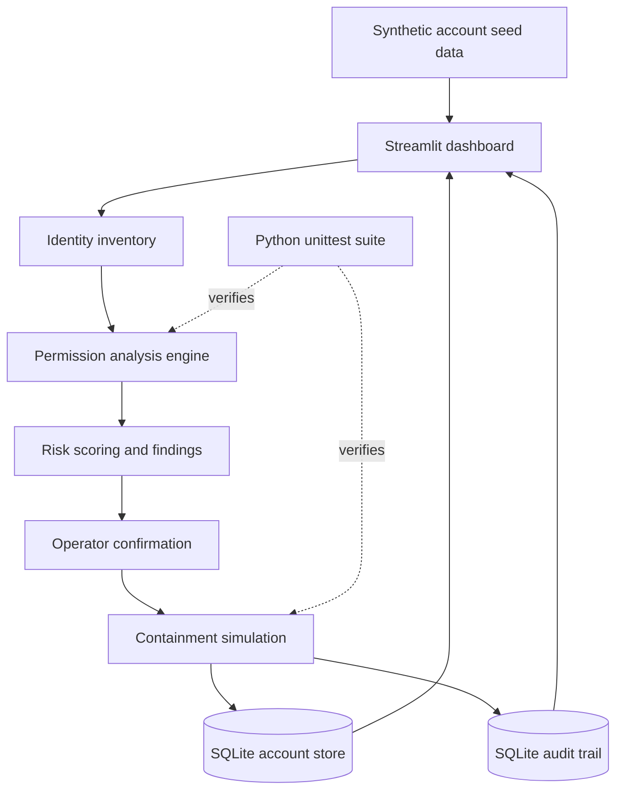

# RogueGuard

**A defensive service-account security auditing and containment simulator.**

RogueGuard demonstrates how an organisation can compare service-account permissions against an expected access profile, identify excessive grants, prioritise findings, simulate containment, and preserve before-and-after evidence.

> **Scope notice:** RogueGuard currently runs as a local synthetic simulation using Python, Streamlit, and SQLite. It does not connect to or modify Google Cloud IAM, IAM Credentials, Cloud Storage, Secret Manager, Cloud Logging, or Floci. Cloud integration and live identity discovery are not implemented or verified.

<p align="center">
  
  
  
  
  
</p>

## Why this project?

Service accounts are non-human identities used by applications and automated workloads. Their permissions can drift beyond what their intended function requires. Excessive privileges can increase the potential impact of a compromised or misused identity.

RogueGuard provides a controlled learning environment for exploring this defensive workflow:

1. Maintain an inventory of synthetic service identities.
2. Compare granted roles with declared required roles.
3. Identify excess and missing permissions.
4. Calculate a transparent, illustrative risk score.
5. Simulate least-privilege containment and quarantine.
6. Preserve before-and-after state in a local audit trail.
7. Verify the behaviour with automated tests.

## Demo scenario

The seeded environment contains four fictional service accounts. The baseline deliberately includes one overprivileged account:

| Synthetic identity | Intended access | Baseline finding |
|---|---|---|
| `svc-library-reader` | `storage.objectViewer` | No excess grants |
| `svc-results-export` | `storage.objectViewer` | Three excess grants |
| `svc-backup-agent` | Viewer and object creator | No excess grants |
| `svc-reporting-old` | No active permissions | No excess grants |

The `svc-results-export` scenario includes `storage.objectAdmin`, `secretmanager.secretAccessor`, and `iam.serviceAccountTokenCreator` beyond its declared requirement.

This is a deliberately misconfigured synthetic identity. The prototype does **not** discover a real attacker, establish who changed a policy, or prove malicious intent.

## Features

- **Identity inventory:** view synthetic principal, owner, purpose, resource scope, granted roles, and required roles.
- **Permission analysis:** compare granted and required roles to identify excess and missing grants.
- **Risk prioritisation:** calculate a bounded score using documented role weights.
- **Containment simulation:** retain only the selected required roles and mark the synthetic account as quarantined.
- **Evidence preservation:** record original and resulting roles, status, removed roles, timestamp, and outcome.
- **Controlled reactivation:** reactivate without restoring removed permissions.
- **Demo reset:** restore the synthetic seed scenario and clear local audit events.
- **Automated tests:** exercise core analysis and database containment behaviour.

## Architecture



The application is organised into three main layers:

| Component | Responsibility |
|---|---|
| `app.py` | Streamlit presentation and operator interactions |
| `core.py` | Permission comparison, risk scoring, remediation calculation, and simulated access decisions |
| `database.py` | SQLite persistence, seed data, transactional containment, reactivation, audit records, and demo reset |

See [architecture and threat model](docs/architecture.md) for data flow, trust boundaries, assumptions, and limitations.

## How detection works

The current detection rule compares the roles granted to an account with the roles declared as required for its synthetic purpose.

```text
Excess roles  = Granted roles - Required roles
Missing roles = Required roles - Granted roles
```

The risk engine assigns predefined weights to excess roles, multiplies the total by eight, and caps the score at 100. The resulting classification is a demonstration heuristic, not a cloud-provider risk rating or a calibrated measure of incident likelihood.

**Important assumption:** the prototype trusts the `required_roles` values in its seed data. It does not independently establish the correct permissions from workload telemetry, owner approval, or cloud policy history.

## Containment workflow

1. The operator selects an active synthetic account.
2. The application displays the excess grants and proposed retained roles.
3. The operator confirms the action.
4. The database layer validates that retained roles were originally granted and are included in the declared required roles.
5. A SQLite transaction updates the roles, marks the account `QUARANTINED`, and records before-and-after evidence.
6. The dashboard refreshes and displays the updated state.

The access-decision function simulates denial for quarantined accounts. No real IAM policy, credential, token, or cloud resource is changed.

## Technology stack

- Python 3.10+
- Streamlit
- SQLite via Python's `sqlite3`
- JSON serialisation
- Python standard-library `unittest`
- Git and GitHub Actions

## Run locally

### 1. Clone the repository

```bash
git clone https://github.com/Ayush-Iyer1611/RogueGuard.git
cd RogueGuard
```

### 2. Create and activate a virtual environment

Linux/macOS:

```bash
python3 -m venv .venv
source .venv/bin/activate
```

Windows PowerShell:

```powershell
py -m venv .venv
.venv\\Scripts\\Activate.ps1
```

### 3. Install dependencies

```bash
python -m pip install --upgrade pip
pip install -r requirements.txt
```

### 4. Start the dashboard

```bash
streamlit run app.py
```

Open the local address printed by Streamlit (usually http://localhost:8501).

## Run tests

```bash
python -m unittest discover -s tests -v
```

The current suite contains 17 tests across the core security logic and SQLite workflows. A passing suite verifies only the behaviours covered by those tests; it is not proof of production security or cloud integration.

GitHub Actions runs the test suite on pushes to `main` and pull requests targeting `main`.

## Repository structure

```text
RogueGuard/
├── app.py
├── core.py
├── database.py
├── requirements.txt
├── docs/
│   ├── architecture.md
│   ├── project_synopsis.md
│   ├── test_matrix.md
│   └── findings_register.md
├── tests/
│   ├── test_core.py
│   └── test_database.py
└── .github/
    ├── workflows/
    │   └── tests.yml
    ├── ISSUE_TEMPLATE/
    └── pull_request_template.md
```

## Security and safe-use boundaries

- Use synthetic records only.
- Run locally or in an explicitly assigned and approved training environment.
- Do not use real student data, production credentials, or third-party resources.
- Do not treat the local simulation as a live cloud security control.
- Do not claim a cloud operation succeeded unless it has been independently verified in an authorised environment.
- See [SECURITY.md](SECURITY.md) for reporting and scope guidance.

## Roadmap

- [x] Synthetic identity inventory
- [x] Excess-permission analysis
- [x] Demonstration risk scoring
- [x] Local containment and quarantine simulation
- [x] Before-and-after audit evidence
- [x] Unit and database tests
- [ ] Validate supported cloud operations in the assigned sandbox, with approval
- [ ] Implement verified cloud identity discovery and policy integration
- [ ] Add owner approval and permission-baseline provenance
- [ ] Evaluate stronger audit integrity and centralised logging

Items not checked are future work, not current capabilities.

## Acknowledgements

Developed as a defensive cybersecurity learning project in the context of a synthetic service-account security scenario.

## License

No license is currently declared. Unless a license is added, standard copyright restrictions apply and reuse is not automatically granted.
