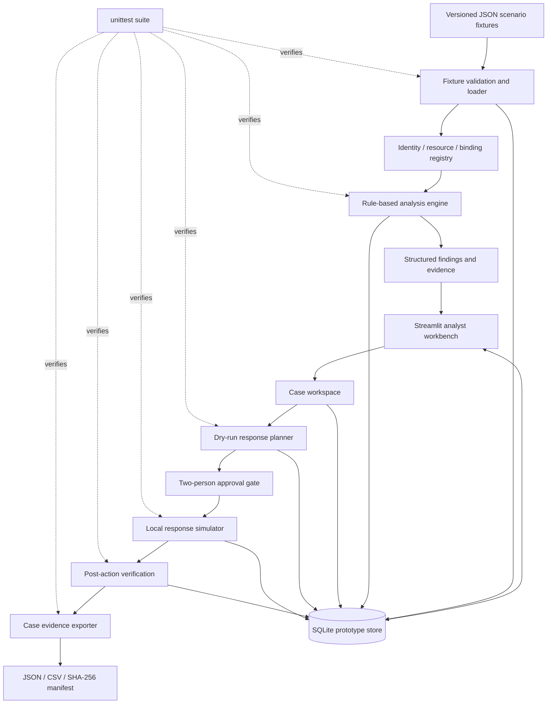

# Architecture and Threat Model — RogueGuard v0.9

## 1. System purpose and release boundary

RogueGuard v0.9 is a local, synthetic identity-security workbench. It demonstrates how an analyst can load identity and resource fixtures, review permission findings, create a case, preview a response plan, obtain a separate reviewer decision, simulate the action, verify the result, and export evidence.

It does **not** connect to a cloud provider or change real IAM policies, credentials, storage, secrets, or workload identities. Provider adapters and cloud operations remain separate future work requiring explicit sandbox approval and operation-level verification.

## 2. Current logical architecture



## 3. Code components

| Component | Responsibility |
|---|---|
| `app.py` | Streamlit overview, identity explorer, finding inbox, response lab, case and evidence views |
| `prototype.py` | Fixture validation/import, SQLite schema, detection rules, finding/case lifecycle, response plans, approvals, simulated actions, verification, and evidence export |
| `core.py` | Original v0.1 permission-set comparison, illustrative risk score, remediation calculation, and simulated access decision |
| `database.py` | Original v0.1 account store, containment, reactivation, audit, and demo reset |
| `fixtures/scenarios/` | Versioned synthetic identity, resource, baseline, binding, and relationship data |
| `tests/` | Unit, database, and v0.9 analyst workflow tests |
| `evidence/exports/` | Local generated case exports; ignored by Git |

## 4. Data model

| Entity | Purpose |
|---|---|
| Scenario | Versioned synthetic investigation context |
| Identity | Principal, type, owner, purpose, environment, lifecycle, observation and review dates |
| Resource | Project, bucket, or service with environment and sensitivity |
| Baseline | Required roles, rationale, owner, approval state and version |
| Role binding | Principal + role + resource + source + optional condition/inheritance |
| Relationship | Synthetic relation such as token creator, can impersonate, or used by |
| Finding | Rule ID, principal, resource, role, severity, confidence, evidence, recommendation and state |
| Case | Groups findings, plans, approvals and evidence |
| Action plan | Proposed action and before/after snapshot |
| Approval | Independent reviewer decision and rationale |
| Event | Case timeline for plan, approval, execution, verification and state changes |
| Finding history | Actor, old/new finding state, reason and timestamp |

## 5. Analysis rules currently implemented

- `EXCESS_ROLE`: observed role is not present in the declared required-role baseline.
- `MISSING_REQUIRED_ROLE`: baseline includes a role with no matching binding.
- `UNKNOWN_ROLE`: role is not part of the prototype role catalogue.
- `BROAD_RESOURCE_SCOPE`: selected non-viewer role is bound at project or folder scope.
- `MISSING_OWNER`: identity has no recorded owner.
- `STALE_ACCESS_REVIEW`: review date is in the past.
- `INVALID_REVIEW_DATE`: review metadata cannot be parsed as an ISO date.

Rules operate on fixture data. They do not establish live identity behaviour, actual permission usage, or intent. Finding severity and confidence are distinct. Confidence is currently based on whether the synthetic baseline is marked approved; it is not a statistical confidence interval.

## 6. Response workflow and safety controls

1. The analyst selects findings and opens a case.
2. A dry-run plan stores the original and proposed identity/binding snapshots.
3. Permission reduction and quarantine are separate actions.
4. A reviewer different from the plan creator must approve or reject the plan.
5. Execution is allowed only for an approved plan.
6. The simulator checks that the current state still matches the reviewed precondition.
7. The local database is updated transactionally.
8. Verification compares the resulting state with the reviewed expected state.
9. Finding and case events are retained in the local prototype store.
10. A case export contains JSON, CSV, and a SHA-256 manifest.

Reactivation is gated: the identity must be quarantined, and the remaining role bindings must fit the declared required-role baseline. A prior excess grant is not silently restored.

## 7. Trust boundaries and assumptions

- Fixture files and the local SQLite database are synthetic inputs.
- Required-role baselines are supplied by the scenario and are not independently validated against a real workload.
- Relationship edges are scenario assertions, not discovered trust paths.
- The local operator identity fields are labels entered in the UI, not authenticated enterprise identities.
- Two-person approval is a workflow simulation, not an independently authenticated approval system.
- SQLite and the hash manifest are not immutable or independently protected evidence storage.
- A local simulated result is not evidence of a cloud-side change.

## 8. Threat scenarios explored

| Scenario | v0.9 behaviour | Limitation |
|---|---|---|
| Excess privilege | Flags role bindings outside the declared baseline | Baseline itself may be wrong or stale |
| Unknown role | Flags role outside the local catalogue | Catalogue is intentionally small and not provider-complete |
| Broad scope | Identifies selected roles attached to project/folder resource fixtures | No provider policy inheritance evaluation |
| Missing owner / stale review | Produces metadata findings | No organisation directory or lifecycle source |
| Delegation relationship | Displays fixture relationship graph | No real graph discovery or transitive cloud privilege calculation |
| Unsafe response request | Requires independent reviewer and checks stale plan state | Reviewer labels are not authenticated |
| Quarantine | Simulates lifecycle state transition | Does not disable a real service account or revoke credentials |
| Evidence tampering | Exports hashes for generated files | No immutable storage or trusted timestamping |

## 9. Out of scope for v0.9

Live cloud IAM discovery, policy write operations, credential/token revocation, production alerting, provider audit-log ingestion, calibrated risk prediction, immutable evidence storage, enterprise SSO, multi-tenant isolation, and production authorisation enforcement.

## 10. Verification

Run:

```bash
python -m unittest discover -s tests -v
```

The automated suite checks the implemented local paths. The academic T01–T08 manual review matrix must still be executed with captured evidence before the v1.0 submission.
