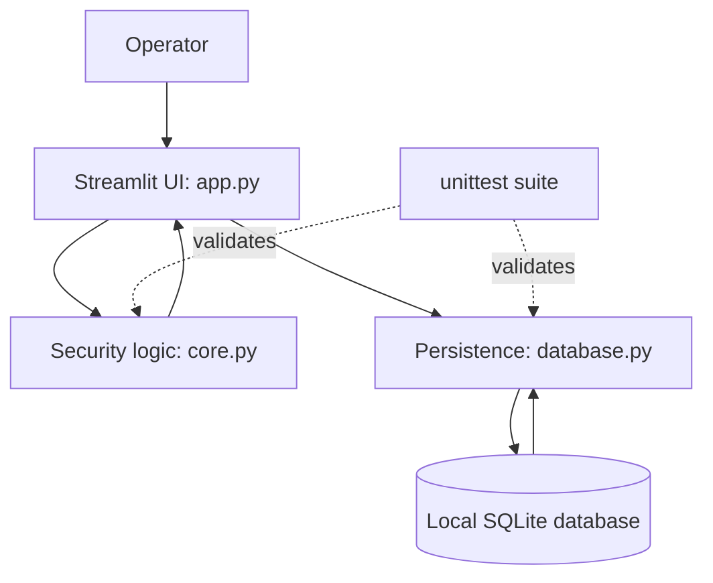

# Architecture and Threat Model

## 1. System purpose

RogueGuard is a local defensive prototype for reviewing synthetic service-account permission assignments and demonstrating a containment workflow. It is not a cloud identity discovery product and does not connect to a cloud provider.

## 2. Logical architecture

## 3. Components

- **Presentation — `app.py`:** renders inventory, containment controls, metrics, and audit trail.
- **Security engine — `core.py`:** compares granted and required roles, calculates an illustrative risk score, computes a retained role set, and simulates access decisions.
- **Persistence — `database.py`:** seeds synthetic identities, reads and updates records, records audit events, and performs containment/reactivation/reset operations.
- **Database — SQLite:** stores local synthetic account and audit records.
- **Verification — `tests/`:** checks core logic and database workflows using Python's standard-library test framework.

## 4. Data flow

1. Synthetic seed records are inserted into SQLite when the account table is empty.
2. The dashboard reads account records and displays their purpose, owner, resource scope, roles, and status.
3. The core engine compares granted roles with declared required roles.
4. The operator reviews the proposed action and explicitly confirms containment.
5. The database layer validates the requested retained roles.
6. A transaction updates the local account state and writes a before/after audit record.
7. The dashboard reloads data from SQLite.

## 5. Trust boundaries and assumptions

- The operator is trusted to use the local training application responsibly.
- Seed data and the local SQLite database are synthetic and controlled by the project.
- The declared required-role list is treated as the expected baseline; the prototype does not independently validate it.
- The application process and local database file are within the same local trust boundary.
- The audit table is not tamper-proof and is not stored in an independent security boundary.

## 6. Threat scenarios considered

| Scenario | Current prototype response | Limitation |
|---|---|---|
| An account has excess roles | Flags roles outside declared requirements | Does not establish who granted them or why |
| An account is quarantined | Simulated access decisions deny it | Does not revoke cloud credentials or tokens |
| A containment request includes an undeclared role | Database validation rejects it | Validation is against synthetic local records |
| A database operation fails | Transaction is rolled back | Does not provide distributed transaction guarantees |
| An unknown identity is created in a cloud project | Not detected | No live identity discovery or cloud event ingestion |

## 7. Security controls demonstrated

- Least-privilege comparison against a declared baseline.
- Human confirmation before the UI invokes containment.
- Validation that retained roles were originally granted and are declared required.
- Transactional update of local account state and audit evidence.
- Reactivation without restoring removed grants.
- Automated tests for expected and rejected operations.

## 8. Out of scope

The current version does not implement live cloud IAM integration, identity provenance, cloud audit-log ingestion, anomaly detection, credential or token revocation, tamper-resistant logging, or production-grade authorisation enforcement.

## 9. Future validation

Any cloud integration must be developed and tested only in the explicitly assigned sandbox, after mentor approval. Each provider operation must be verified individually; an enabled service or available endpoint is not proof that a specific operation is supported.
